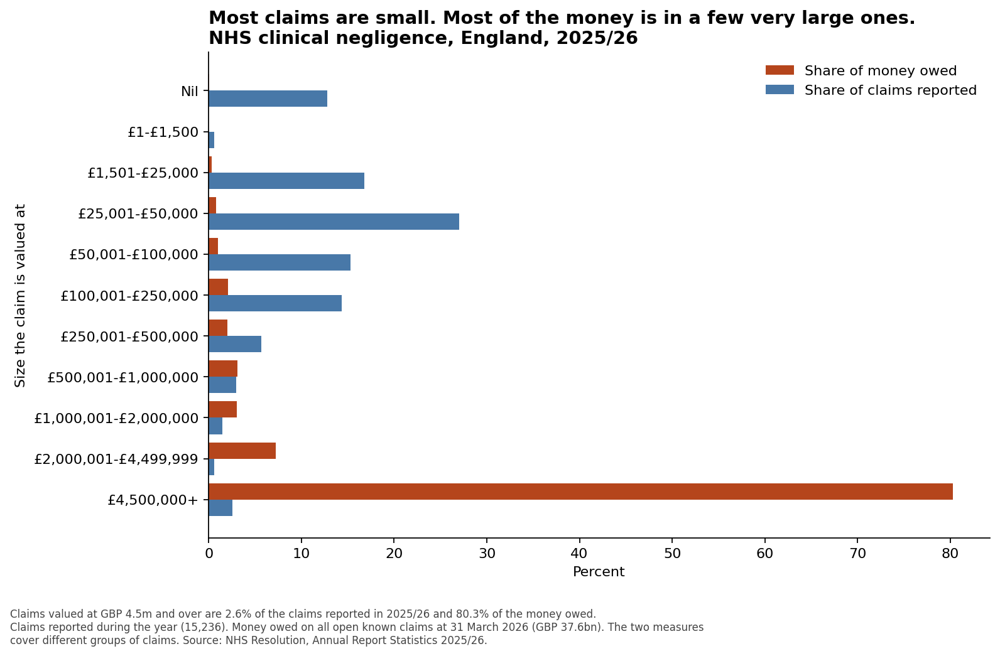
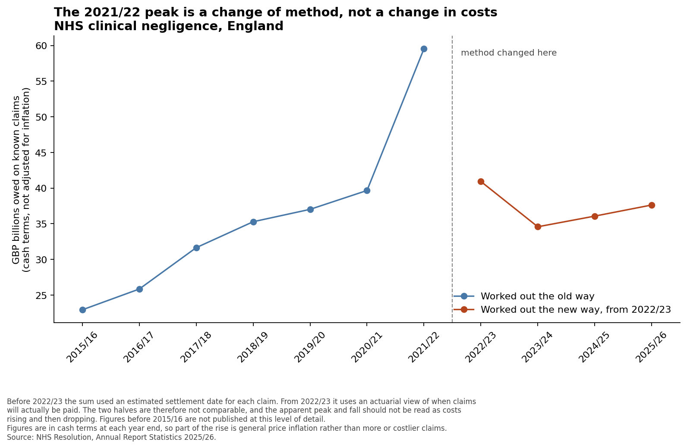

# Where the money sits in NHS clinical negligence claims

**In one sentence:** a small group of birth-injury claims accounts for more than half of all the
money the NHS in England owes on clinical negligence claims, while the great majority of claims
account for very little of it.


## The question

When the NHS is sued over care that went wrong, the money owed has to be estimated years before
most of it is paid. If that money is spread evenly across all claims, planning for it is
straightforward. If a handful of claims drive most of the cost, it is not, because a change in a
few large cases moves the total far more than a change in the many small ones.

So: **which parts of the NHS account for the money owed, and how concentrated is it?**

## What the figures show

In 2025/26:

- The NHS in England owed **£37.6 billion** on clinical negligence claims it already knows about.
- **15,236** new claims were reported during the year.
- **Obstetric claims involving cerebral palsy or brain damage** made up about **1.7%** of the
  claims reported, and account for about **55%** of the money owed.
- **Four categories account for 80%** of the money: obstetric brain injury, paediatrics, the mixed
  "Other" grouping, and other obstetric claims.
- At the opposite end, the "Other" grouping produced **39% of claims** and about **8%** of the
  money.

## The same answer, reached a second way

A finding from one angle can be an accident of how the data happens to be grouped. So the same
question was asked again using the other split the spreadsheet offers: the size each claim is
valued at, rather than which part of the NHS it came from.



It agrees, and more sharply. **Claims valued at £4.5 million and over are 2.6% of the claims
reported and account for 80.3% of the money owed**, £30.2bn of the £37.6bn. At the other end,
about 72% of claims are valued under £100,000 and together account for under 3% of the money.

Once you think about what a birth injury means, the result makes sense. A child who needs care for
the whole of a normal lifespan is enormously expensive to compensate, while most claims are far
smaller. This is the usual shape of insurance costs, and it is why an average claim cost on its own
tells you almost nothing.

## Two things in the data that could have produced a wrong answer

**Nine years of zeros that are not zeros.** The money column reads 0 for every year from 2006/07
to 2014/15. That is not because nothing was owed. NHS Resolution's own notes say this level of
detail "is only available from 2015/16 onwards". Charting those years as written would show costs
appearing out of nowhere. They are excluded.

**A £20 billion jump that is a change of method, not of reality.** Money owed runs £37.0bn, then
£39.7bn, then £59.5bn in 2021/22, then falls back to £40.9bn. The notes explain that from 2022/23
the sum is worked out differently, using an actuarial view of when claims will be paid rather than
an estimated settlement date. Figures either side of that change are not measuring the same thing,
so the two halves are drawn as separate lines rather than joined into one.



## What this does not show, and one thing to read carefully

The two bars on the chart are **not two slices of one pie**. Claims reported counts claims that
arrived during the year. Money owed covers every claim still open at the year end, including ones
reported long before. Brain injury claims take years to resolve, so they build up in the open pile.
It would be wrong to say "1.7% of claims cause 55% of costs". What is right, and is still the
point, is that this category is a small share of new claims and a very large share of money owed.

**The money figures are in cash terms and are not adjusted for inflation.** They are deliberately
left that way. These are not records of past spending but estimates, made at each year end, of
money expected to be paid in future, and they already contain assumptions about future inflation
and are discounted to a present value. Deflating them by past inflation would mix two different
things and make the result harder to read, not easier. So the honest statement is that a change
between years reflects some combination of price inflation, the number and size of claims, and the
discount rate used, and this published table cannot separate those three. None of this touches the
main finding, because every share quoted here sits inside a single year.

The figures also say nothing about whether care is getting better or worse, nothing about fault,
and nothing about Scotland, Wales or Northern Ireland. NHS Resolution covers England only.

Counts below 5 and amounts below £5,000 are hidden in the published data to protect patient
privacy. Those are treated as missing, never as zero.

## Where the numbers come from

NHS Resolution, *Annual Report Statistics 2025/26*, covering 2006/07 to 2025/26.
Published at <https://resolution.nhs.uk/resources/annual-statistics-including-factsheet-5/>

## Running it yourself

Two commands. The first installs the tools, the second does everything else: download the
spreadsheet, clean it, work out the figures, draw both charts and run the checks.

```
make setup
make
```

The spreadsheet is downloaded once and reused, and the exact versions of every tool are pinned in
`requirements.txt`, so running this next year gives the same answer rather than whatever the
newest version happens to produce.

To run a single step on its own:

```
./.venv/bin/python src/fetch_data.py    # download the published spreadsheet
./.venv/bin/python src/clean_data.py    # turn it into clean tables
./.venv/bin/python src/analyse.py       # work out the shares and check they add up
./.venv/bin/python src/chart.py         # draw all three charts
make test                               # run the checks on their own
```

## How it is put together

| Folder | What is in it |
|---|---|
| `src/` | The four steps: fetch, clean, analyse, chart |
| `Makefile` | Runs all four in order with one command |
| `requirements.txt` | Exact tool versions used to produce the published result |
| `data/raw/` | The spreadsheet exactly as published, never edited |
| `data/processed/` | Clean tables written by the cleaning step |
| `outputs/` | The chart and the summary table |
| `tests/` | Checks on the cleaning rules, and that our figures match the published totals |
| `NOTES.md` | Every judgement call made along the way, and why |

Every time the analysis runs, it checks that the specialty figures add up to the totals NHS
Resolution publishes. If they ever stop matching, the run stops with an error rather than quietly
publishing a wrong number. Both currently reconcile exactly.

Raw data is never edited by hand. Every change happens in a script, so anyone can see what was done
and get the same answer. `NOTES.md` is the honest record of the decisions, including the ones that
were not obvious.
